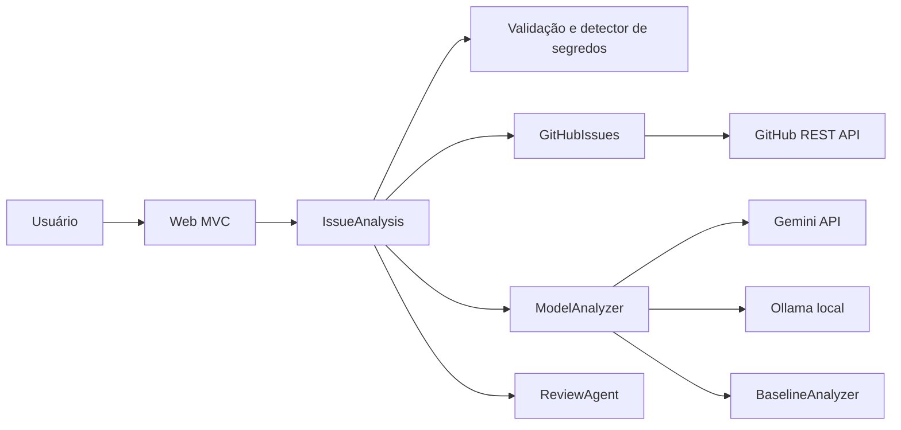

# Arquitetura

`Domain` contém os contratos de entrada e saída. `Application` orquestra a análise, a triagem local, avaliação de qualidade e revisão. `Infrastructure` implementa as chamadas HTTP ao GitHub e aos modelos. `Web` recebe os formulários e apresenta o resultado codificado pelo Razor.

O fluxo de URL transforma uma URL validada em segmentos `owner/repo/number`; nunca faz `GET` na URL enviada. A busca de duplicatas usa a API de pesquisa do GitHub. O modelo recebe instruções de tratar o conteúdo como dados; o resultado é aceito apenas se cumprir o formato esperado. O `ReviewAgent` normaliza hipóteses e marca baixa confiança. A aplicação não contém chamadas de escrita ao GitHub.

`SqliteAnalysisHistory` registra apenas data UTC, modo e nota. A documentação OpenAPI dos endpoints JSON está disponível em `/openapi/v1.json` em ambiente de desenvolvimento.

Os quatro agentes são etapas explícitas em `IssueAnalysis`: `TriageAgent` gera a classificação, `QualityCoachAgent` consolida lacunas e ações, `DuplicateAgent` pesquisa a API e `ReviewAgent` marca baixa confiança e normaliza hipóteses. `DraftCoachAgent` valida se o Markdown do modelo está completo e usa o rascunho local como alternativa quando não está. O baseline evita alegações não verificadas quando a IA não está configurada.

Os clientes HTTP usam destinos fixos, tempo limite e não seguem redirecionamentos. Os logs informativos de `HttpClient` são desativados porque a URL de busca do GitHub pode conter parte do título da issue. O formulário usa antiforgery e a interface codifica a saída do modelo. No Azure, os metadados SQLite ficam em `%HOME%/data/IssuePilot`, fora do diretório publicado.

## Próximas decisões

Antes do deploy público, definir prazo de retenção dos metadados SQLite e verificar limites gratuitos dos provedores.
