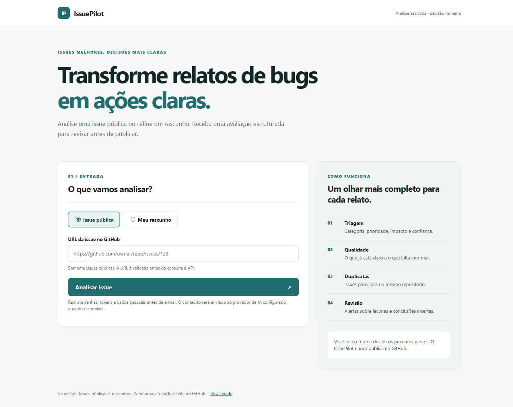

# IssuePilot

**Transforme relatos de bugs em ações claras.** MVP em ASP.NET Core MVC para analisar issues públicas do GitHub e melhorar rascunhos antes da publicação.



[Ver o layout em celular](docs/screenshots/mobile-entrada.png)

## Estado atual

Os dois modos funcionam. A análise com `gemini-3.5-flash-lite` respondeu em um teste com issue pública real em 11/11/2026. Sem `GEMINI_API_KEY`, a análise usa regras locais e marca prioridade/impacto como **A verificar**. O app não escreve no GitHub. O resultado é exibido como texto seguro e a decisão final é do usuário.

## Executar

Requer .NET SDK 10. Na raiz:

```powershell
dotnet restore IssuePilot.slnx
dotnet run --project IssuePilot.Web
```

Abra a URL local indicada pelo ASP.NET. Para usar Gemini, configure `GEMINI_API_KEY` como variável de ambiente. O modelo padrão é `gemini-3.5-flash-lite`, com raciocínio mínimo e tempo limite de 60 segundos; mude com `ISSUEPILOT_GEMINI_MODEL`. O antigo `gemini-2.5-flash` pode retornar HTTP 404 em projetos novos. Para Ollama local, instale o Ollama e configure `ISSUEPILOT_MODEL_PROVIDER=ollama` e, se necessário, `ISSUEPILOT_OLLAMA_MODEL`. O endpoint Ollama é fixo em `127.0.0.1:11434`.

No Windows, [Start-IssuePilot.ps1](Start-IssuePilot.ps1) pede a chave com a digitação oculta e inicia o site em `http://127.0.0.1:5191/`. A chave fica somente na variável de ambiente do processo e é removida quando o script termina. Use uma issue pública para confirmar que o relatório mostra `Modo: gemini-3.5-flash-lite`. Se o modelo não responder, o modo local mostra apenas um motivo seguro, como código HTTP ou timeout; nenhuma chave ou resposta bruta aparece na página.

Se a política do PowerShell bloquear arquivos `.ps1`, execute [Start-IssuePilot.cmd](Start-IssuePilot.cmd) na pasta do projeto. Ele faz a mesma solicitação de chave sem alterar a política de segurança do Windows.

Os endpoints JSON `POST /api/analysis/draft` e `POST /api/analysis/url` são descritos em `/openapi/v1.json`. O app usa OpenAPI do ASP.NET Core; uma interface Swagger visual ainda não foi adicionada.

Nenhuma chave deve ser colocada em `appsettings.json` ou no frontend. O uso da API Gemini deve ser acompanhado no painel de cotas gratuitas; o código não contrata serviços.

## Segurança

- Aceita apenas URL HTTPS exata `github.com/{owner}/{repo}/issues/{number}`; consulta a REST API no host fixo `api.github.com`, sem seguir redirecionamentos.
- Limita título, descrição e corpo HTTP; aplica rate limit e timeouts.
- Detecta padrões comuns de segredos e bloqueia a chamada ao modelo. Esta detecção não substitui uma revisão humana para dados pessoais ou segredos fora dos padrões.
- Trata o corpo da issue como dado não confiável; saída do modelo passa por validação de formato, tipos, faixas e tamanho. Resposta inválida usa o analisador local.
- O Razor codifica o texto exibido, inclusive Markdown. Formulários POST usam antiforgery token; uma CSP restringe scripts e recursos.
- Nenhum conteúdo de issue, token ou IP é gravado explicitamente em logs. Não há persistência de relatos no MVP atual.

## Arquitetura

Veja [ARCHITECTURE.md](ARCHITECTURE.md). Projetos: `IssuePilot.Web`, `IssuePilot.Application`, `IssuePilot.Domain`, `IssuePilot.Infrastructure`, `IssuePilot.Tests`.

## Testes

```powershell
dotnet test IssuePilot.Tests/IssuePilot.Tests.csproj
```

Neste ambiente, os testes xUnit passaram após restaurar os pacotes pelo NuGet. O comando de teste precisa de acesso a soquetes locais fora do sandbox da sessão.

## Limites conhecidos

- Busca de duplicatas é uma sugestão simples pela pesquisa do GitHub no mesmo repositório; não mede similaridade semântica.
- SQLite armazena somente data UTC, modo e nota de qualidade de cada análise. Texto, título e URL não são persistidos. Metadados com mais de 30 dias são removidos na próxima análise.
- A instalação local do Ollama não foi encontrada neste notebook; a capacidade de executá-lo ainda não foi confirmada.
- Sem chave Gemini, a análise local não infere causas e mantém baixa confiança.

## Deploy gratuito

O [Azure App Service F1 para Windows](https://azure.microsoft.com/en-us/pricing/details/app-service/windows/) aparece na tabela oficial como gratuito, com cotas pequenas e sem SLA. O [guia oficial de ASP.NET Core](https://learn.microsoft.com/en-us/azure/app-service/quickstart-dotnetcore) inclui .NET 10 e a opção F1. A conta e a região ainda precisam ser verificadas antes de criar recursos; não foi feito deploy nem ativado serviço pago. Veja [DEPLOYMENT.md](DEPLOYMENT.md) para os limites e a configuração segura da chave. SQLite funciona localmente, mas o armazenamento compartilhado do App Service exige avaliação específica antes de usá-lo como histórico persistente.

## Entrega

O plano diário está em [PLAN.md](PLAN.md). Materiais de apresentação estão em [PRESENTATION.md](PRESENTATION.md).
Resultados de execução com issues públicas estão em [EVALUATION.md](EVALUATION.md).
O repositório Git local ainda não tem remoto configurado; o workflow de CI só poderá ser observado no GitHub após a publicação.
